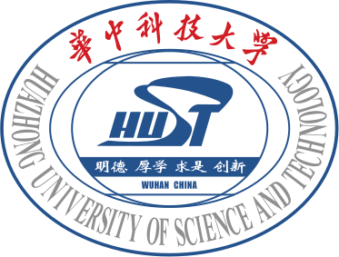

## About Me

I am an M.S. student in Electrical and Computer Engineering at the University of Michigan, advised by [Prof. Liyue Shen](https://liyueshen.engin.umich.edu/). I also work with [Prof. Yingbin Liang](https://sites.google.com/view/yingbinliang/home) at The Ohio State University. Before that, I received my B.Eng. in Computer Science from Huazhong University of Science and Technology (HUST).

## Research Interests

My research centers on **generative models**. Specifically, I am interested in:

- **Multimodal systems** (VLM, VLA, etc.)
- **Model architecture & Mechanistic interpretability**
- **Real-world applications** (healthcare, science, robotics, etc.)



## Experience

  

    TeleAI @ China Telecom
    Aug. 2024 – Jan. 2025
  

  
Software Engineer Intern, Mentor: <a href="https://qzweng.github.io/">Dr. Qizhen Weng</a>

  
Customized and deployed Ulysses context-parallel distributed training framework for video DiT, including HunyuanVideo, Wan, and internal T2V/I2V models.

## Education

  
  

    

      University of Michigan
      Sep. 2025 – Jun. 2027 (expected)
    

    
M.S. in Electrical and Computer Engineering

  

  
  

    

      Huazhong University of Science and Technology
      Sep. 2021 – Jun. 2025
    

    
B.Eng. in Computer Science

  

